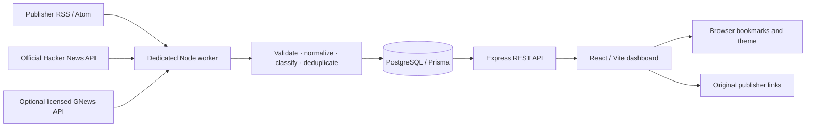

# TechSpill

**Spilling What’s Next.** The reader now has a dark-first editorial design, responsive navigation, keyboard search, grid/Quick Spill views, and a redesigned BD Tech Scene. See [TECHSPILL.md](TECHSPILL.md) for the design system, compatibility details, and verification.

**Bangladesh Tech:** the existing reader now includes `/bangladesh`, strict regional relevance checks, verified English/Bengali RSS sources, scoped APIs and review tools. See [BANGLADESH.md](BANGLADESH.md) for source verification, upgrade steps, API filters and administration.

A full-stack technology news reader backed by real RSS/Atom feeds and the official Hacker News API. React never contacts news publishers: a dedicated worker collects metadata into PostgreSQL, and an Express API serves the reader.

## Run locally

Requires Node.js 22+, npm 9+, and PostgreSQL 15+ with permission to create the `pg_trgm` extension. Docker is optional. No news API key is required for the six default sources.

```bash
npm ci
cp .env.example .env
npm run db:generate
```

Choose one database option:

- Use an existing PostgreSQL database and set `DATABASE_URL` in `.env`.
- Run `npm run db:local` in a separate terminal. This starts an actual, project-local PostgreSQL 17 server on `127.0.0.1:5432`; data persists under ignored `.local/postgres`. The development credentials match `.env.example`. Keep this terminal open. It does not install a system service or change system users.

Then:

```bash
npm run db:migrate
npm run db:seed
npm run dev
```

Open **http://localhost:5173**. The API listens on **http://localhost:4000**. `npm run dev` starts all three apps; the worker collects on startup and then on its schedule. An initial collection usually takes 10–60 seconds, depending on provider availability. An empty database displays an honest waiting state until real records arrive.

```bash
npm run collect             # one eligible collection pass, then exit
npm run typecheck
npm test                    # mocked upstreams + API validation + UI tests
npm run test:integration    # requires the migrated PostgreSQL database
npm run build               # typecheck + API, worker and frontend production bundles
```

Integration tests create isolated fixture sources and clean their article data. Use a dedicated test database and stop other workers while running them: they deliberately exercise the singleton lease and source-failure paths. No live news provider is contacted by the automated test suite.

## Architecture



```text
apps/web/       React, TypeScript, Vite, Tailwind, React Router, TanStack Query
apps/api/       Express, Zod validation, CORS, rate limits, structured logs
apps/worker/    Independent adapters, processing, distributed lease, node-cron
packages/shared/ Shared types, request schemas, category catalog, env validation
packages/db/   Prisma client and restricted source catalog
prisma/        Normalized schema, committed SQL migrations, catalog seed
scripts/       Local PostgreSQL, worker health, source-policy configuration
tests/         Vitest, Supertest, React Testing Library, PostgreSQL integration
```

Frontend routes: `/`, `/trending`, `/saved`, `/sources`. Unrecognized routes show a useful 404 page. Search submits with Enter. Search and all filters are encoded in the URL; source selection supports multiple publishers. Dates use UTC boundaries. Regions appear only when source metadata explicitly provides one.

The dashboard polls the **database API** every 60 seconds by default. This does not trigger upstream collection. Refresh controls also only read the database. The displayed “feeds checked” time comes from the latest successful backend feed request, including legitimate HTTP 304 responses; it is never based on a client render or a fabricated counter.

## Sources and publisher policy

| Adapter                    | Upstream                                                                   |
| -------------------------- | -------------------------------------------------------------------------- |
| TechCrunch                 | `https://techcrunch.com/feed/`                                             |
| The Verge                  | `https://www.theverge.com/rss/index.xml`                                   |
| Ars Technica               | `https://feeds.arstechnica.com/arstechnica/index`                          |
| WIRED                      | `https://www.wired.com/feed/rss`                                           |
| Engadget                   | `https://www.engadget.com/rss.xml`                                         |
| Hacker News                | `https://hacker-news.firebaseio.com/v0/topstories.json` and item endpoints |
| GNews, disabled by default | `https://gnews.io/api/v4/top-headlines`                                    |

Hacker News normalization follows its [official API documentation](https://github.com/HackerNews/API). Each publisher has a separate registered adapter and shares the RSS parser. The app does not scrape full articles or bypass paywalls. HN is a community aggregator; some of its links and some general publisher feeds can cover adjacent subjects outside technology. Unmatched stories remain uncategorized and are still available in All News.

By default, publisher excerpts are **off**. Only metadata and feed-provided image URLs are stored; images are referenced directly, never downloaded or proxied. Missing or unavailable images use a neutral visual placeholder. This is not a grant of redistribution rights: review each publisher’s current terms before exposing its metadata, excerpts or image references in a public deployment. Source access is not evidence of a license. Feed HTML is converted to bounded plain text, and full feed bodies are not persisted.

Use the authenticated deployment shell, not a public admin endpoint, to configure known sources:

```bash
npm run source:configure -- wired --images=false
npm run source:configure -- techcrunch --enabled=false
npm run source:configure -- techcrunch --min-poll-minutes=30
# Enable excerpts only when your use is permitted by the source's terms:
npm run source:configure -- techcrunch --excerpts=true
```

These policies clear stored HTTP validators and apply on the next eligible feed response; they do not advance the allowed polling time. Disabling a source stops collection and preserves its previously collected records. Policy changes do not automatically remove historical records; remove previously stored excerpts/images through a controlled database update when rights are revoked. Neither browser requests nor source configuration bypass polling intervals or HTTP cache durations.

For GNews, supply a backend-only `GNEWS_API_KEY`, confirm your plan’s redistribution conditions, then run `npm run source:configure -- gnews --enabled=true`. Its adapter retains the original publisher name. Requests default to at most once per hour and 24 attempts per UTC day, and HTTP 429/Retry-After responses cause backoff. The worker never logs or serves the key. No live GNews verification is possible without a licensed key.

To add a publisher: add its trusted catalog entry, explicitly allow its HTTPS host in `apps/worker/src/utils/http.ts`, implement/register its adapter, review policy flags, and add a mocked adapter test. Source URLs cannot be supplied by API clients. Redirects are manually revalidated against the same host allowlist; credentials, non-HTTPS upstream URLs, custom ports, untrusted hosts, entity declarations, and oversized feed bodies are rejected.

## Collection, deduplication and ranking

- A separate persistent worker runs `node-cron` in UTC (`*/10 * * * *` by default). Closing the website has no effect on collection.
- Sources becoming eligible within one minute of a cron boundary are queued briefly and waited on until their actual allowed polling time. This avoids skipping a whole cycle without requesting upstream early.
- Source-level concurrency is bounded; Hacker News item requests also have a fixed bound. Every request has a timeout and bounded exponential retry with jitter. Cache validators, cache duration and Retry-After are honored. One source failure does not stop the other sources.
- A PostgreSQL lease, atomically acquired, expires after 120 seconds and renews every 15 seconds. Another instance cannot acquire an active lease. Each article write locks and checks the current lease owner in the transaction, fencing stale workers. Expired leases allow recovery after a crash; interrupted job records are reconciled on the next run. Keep machine clocks synchronized.
- `CollectionJob` and per-source `CollectionLog` record attempts, outcomes, inserted/updated/rejected counts, timings, and a sanitized error. Check the database or structured worker logs for the detailed collection history; no unauthenticated worker controls are exposed.
- Canonical URLs remove fragments and known tracking parameters, normalize hosts and sort query parameters. Deterministic SHA-256 identifiers cover missing external IDs. Unique constraints on `(sourceId, externalId)` and `(sourceId, canonicalUrl)` prevent duplicate rows within a source. Repeated ingestion updates metadata and keeps the row ID stable.
- Separate source attributions are retained, even when an aggregator links to a publisher’s existing article. Story clusters use exact normalized headline tokens or conservative Jaccard similarity ≥0.74, at least five tokens, against recent candidate clusters. This heuristic can miss related coverage and occasionally group similar headlines; it does not claim semantic event understanding.
- Coverage counts distinct original publisher **hosts** in a cluster, so a Hacker News link to the same publisher is not counted twice. Hosts are a coverage proxy, not proof of separate company ownership; publisher domains are never used to infer geographic origin.
- Categorization uses title plus available permitted feed metadata and tags. Rules are configurable in `apps/worker/src/processors/article.ts`. An article can have multiple categories or no inferred category. Feed-declared language takes priority; conservative language detection runs only on sufficient text, otherwise language remains unknown.
- Missing, invalid and implausibly future publication timestamps are rejected. PostgreSQL uses timezone-aware timestamps. Author names and descriptions are treated as untrusted plain text. Article URLs must use public HTTP(S); no arbitrary article URL is fetched by the backend.

Default trending formula, recalculated by the worker after collection:

```text
ageHours   = max(0, hours since publication)
freshness  = exp(-ageHours / 24)
coverage   = min(1, log2(max(1, distinct publisher hosts)) / 3)
engagement = min(1, log10(1 + verified HN score) / 3)
score      = 60 × freshness + 25 × coverage + 15 × engagement
```

Missing HN scores contribute zero; views, likes and shares are never invented. This is a calculated editorial ranking, not a real popularity statistic. Weights are configurable. Scores update on worker passes rather than every API request. The API uses stable tie breakers for ordering.

## API

| Method | Endpoint             | Result                                                |
| ------ | -------------------- | ----------------------------------------------------- |
| GET    | `/api/news`          | Paginated, combined search and filters                |
| GET    | `/api/news/latest`   | Same filters, forces newest order                     |
| GET    | `/api/news/trending` | Same filters, forces calculated trending order        |
| GET    | `/api/news/:id`      | One article with publisher link and attribution       |
| GET    | `/api/search`        | Alias of the combined news query                      |
| GET    | `/api/categories`    | Categories with article counts                        |
| GET    | `/api/sources`       | Public source status plus available languages/regions |
| GET    | `/api/health`        | Database readiness and worker collection heartbeat    |

Query parameters:

| Parameter            | Format / default                                                                   |
| -------------------- | ---------------------------------------------------------------------------------- |
| `q`                  | Keyword substring, max 200 characters; title, permitted description, or tags       |
| `category`           | Category slug; comma-separated values use OR                                       |
| `source`             | Source slug; comma-separated values use OR                                         |
| `from`, `to`         | Inclusive ISO 8601 date-time bounds with timezone                                  |
| `language`, `region` | Only values available in source metadata                                           |
| `sort`               | `newest` (default) or `trending`                                                   |
| `page`, `limit`      | `1`, `12`; maximum page 10,000 and limit 50                                        |
| `ids`                | Up to 100 comma-separated article IDs for browser bookmarks; empty returns no rows |

```bash
curl 'http://localhost:4000/api/news?q=AI&category=artificial-intelligence&source=techcrunch,the-verge&sort=newest&page=1&limit=12'
```

```json
{
  "data": [],
  "meta": {
    "page": 1,
    "limit": 12,
    "total": 0,
    "totalPages": 0,
    "lastCollectedAt": null
  }
}
```

The example above shows the empty response shape, not seeded news. Successful singular resources return `{ "data": ... }`. Errors consistently return `{ "error": { "code": "...", "message": "..." } }`; validation errors also include field details. Unknown parameters are rejected. Validation returns 400, missing resources 404, rate limits 429, database readiness failures 503, and unexpected errors 500. Private feed URLs, credentials and worker controls are not returned.

Search uses PostgreSQL case-insensitive matching with GIN trigram indexes for title, description and tag names; publication, ranking, relations, source and language/region fields also have indexes. A bounded in-process API cache lives for 10 seconds. Rate limiting defaults to 120 requests/minute/client per API instance. For a large multi-instance deployment, use shared gateway limits and a shared cache, and evolve offset pagination and cluster matching as volume requires.

## Configuration

Copy `.env.example`. All unprefixed variables remain server-side. Never put database credentials or provider keys in `VITE_*` variables.

| Variable                    | Default / purpose                                                                                            |
| --------------------------- | ------------------------------------------------------------------------------------------------------------ |
| `DATABASE_URL`              | Required PostgreSQL URL; use TLS for managed services and a small connection pool, e.g. `connection_limit=5` |
| `PORT`                      | API port 4000                                                                                                |
| `WEB_ORIGIN`                | Comma-separated exact frontend origins; local default `http://localhost:5173`                                |
| `NODE_ENV`                  | `development` locally, `production` on hosting                                                               |
| `LOG_LEVEL`                 | `info`; structured JSON logs                                                                                 |
| `SERVE_WEB`                 | `true` serves built Vite SPA through Express; default off                                                    |
| `TRUST_PROXY_HOPS`          | Default 0; set only to the verified number of trusted reverse proxies                                        |
| `COLLECTION_CRON`           | `*/10 * * * *`, UTC                                                                                          |
| `COLLECTION_CONCURRENCY`    | 3; supported range 1–8                                                                                       |
| `FETCH_TIMEOUT_MS`          | 15000; supported range 1000–60000                                                                            |
| `FETCH_RETRIES`             | 2 retries, range 0–3                                                                                         |
| `HN_STORY_LIMIT`            | 35, maximum 100                                                                                              |
| `WORKER_STALE_MINUTES`      | 30; increase when using a slower schedule                                                                    |
| `GNEWS_API_KEY`             | Optional licensed-provider secret                                                                            |
| `GNEWS_DAILY_REQUEST_LIMIT` | 24 attempts per UTC day                                                                                      |
| `TREND_FRESHNESS_WEIGHT`    | 60                                                                                                           |
| `TREND_COVERAGE_WEIGHT`     | 25                                                                                                           |
| `TREND_ENGAGEMENT_WEIGHT`   | 15                                                                                                           |
| `VITE_API_URL`              | Empty for Vite proxy / same-origin hosting; otherwise the backend origin without `/api`                      |
| `VITE_REFRESH_INTERVAL_MS`  | 60000; frontend enforces a 15-second minimum                                                                 |
| `API_PROXY_TARGET`          | Optional Vite dev API origin, default `http://localhost:4000`                                                |

Vite variables are build-time values. Configure them before building, then rebuild after changing them. Browser bookmarks and theme use localStorage. No authentication is implemented or required for the public reader; an eventual authenticated bookmark API can replace the isolated preferences hook.

## Production deployment

See [DEPLOYMENT.md](DEPLOYMENT.md) for Docker Compose, Render/Railway, Vercel, migrations, monitoring, and recovery. [VERCEL.md](VERCEL.md) covers the multi-service Vercel project configured in `apps/vercel.json` with web, API, and a private collector daemon. `render.yaml`, `compose.yaml`, `Dockerfile`, and `apps/web/vercel.json` are included. Hosting accounts and paid resources are not provisioned by the project.

For a local production smoke test after building, set `SERVE_WEB=true` and `WEB_ORIGIN=http://localhost:4000`, then run `npm run start:api` and `npm run start:worker` in separate terminals. Open port 4000. The database remains a separate service.

## Verification and phase guide

See [PHASES.md](PHASES.md) for deliverables and verification commands for each requested implementation phase. See [VERIFICATION.md](VERIFICATION.md) for checks performed in the development environment and their limits. CI runs type checking, build, mocked tests, and PostgreSQL integration tests on pushes and pull requests. The optional browser verification script uses the locally installed Chrome via Playwright Core and does not download a browser.
